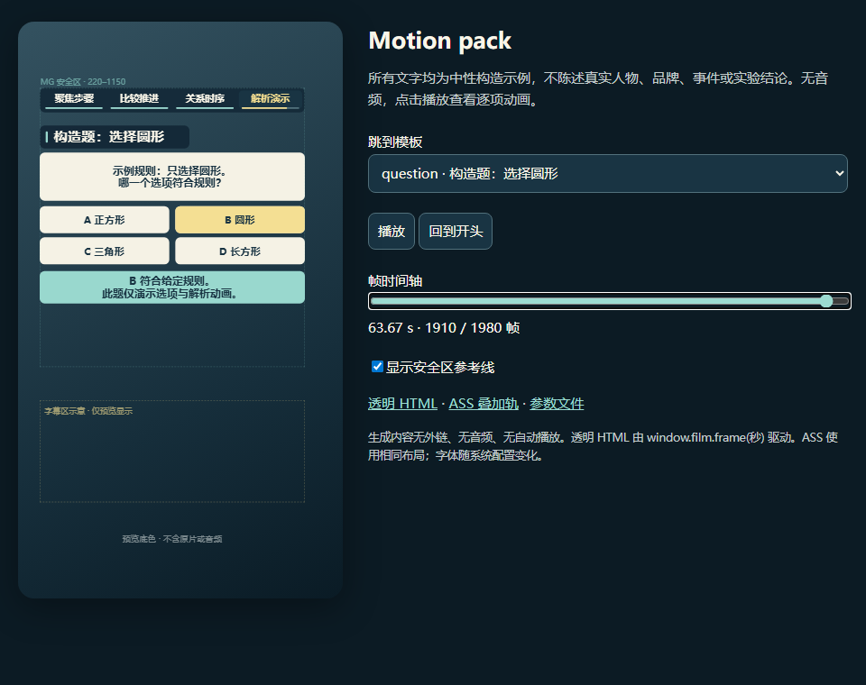

# 中性 MG 演示

[preview.html](preview.html) 是 66 秒无声离线演示；先下载仓库，再在浏览器打开。它包含 9 类卡片与全程章节导航。所有内容为构造示例，不陈述真实人物、品牌、事件或实验结论。



修改 [demo.json](demo.json) 后，在仓库根目录重新生成：

```sh
python scripts/build_motion_pack.py examples/motion/demo.json --out examples/motion
python scripts/test_motion_pack.py
```

`overlay.html` 为透明 HTML 叠加页，等待父级调用 `window.film.frame(seconds)`；直接打开它只会停在第 0 帧。`overlay.ass` 为同布局的 ASS 叠加轨。两者不含底色、参考线、原片、字幕、声音或头像。预览播放器的底色与参考线仅帮助检查位置。

详细参数、时序规则、安全边界与限制见 [模板说明](../../assets/motion/README.md)。可选 `python scripts/test_motion_pack.py --browser` 需要本机已有 Playwright 与 Chromium，会验证浏览器时间跳转并更新本页截图。

[ass-preview.png](ass-preview.png) 是相同示例第 1910 帧的 FFmpeg/libass 实际渲染截图。可在装有 libass 的 FFmpeg 环境复现：

```sh
ffmpeg -y -f lavfi -i "color=c=0x345260:s=1080x1920:r=30:d=0.1" -vf "setpts=PTS+63.6666667/TB,ass=examples/motion/overlay.ass" -r 30 -frames:v 1 -update 1 examples/motion/ass-preview.png
```

这证明该帧在 libass 中可渲染；不同宿主、字体环境及完整成片的验收仍需在实际工程中完成。
